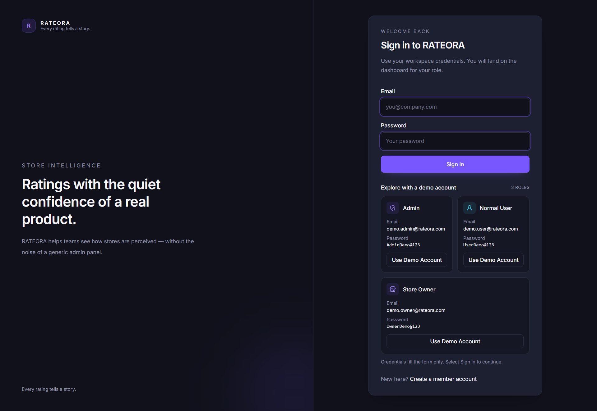
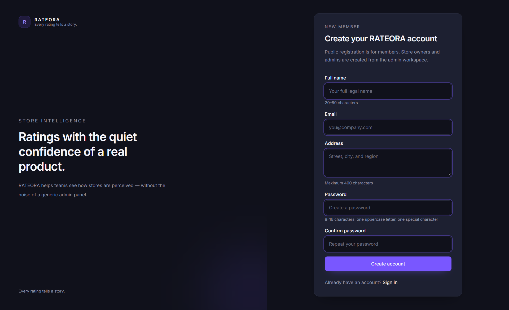
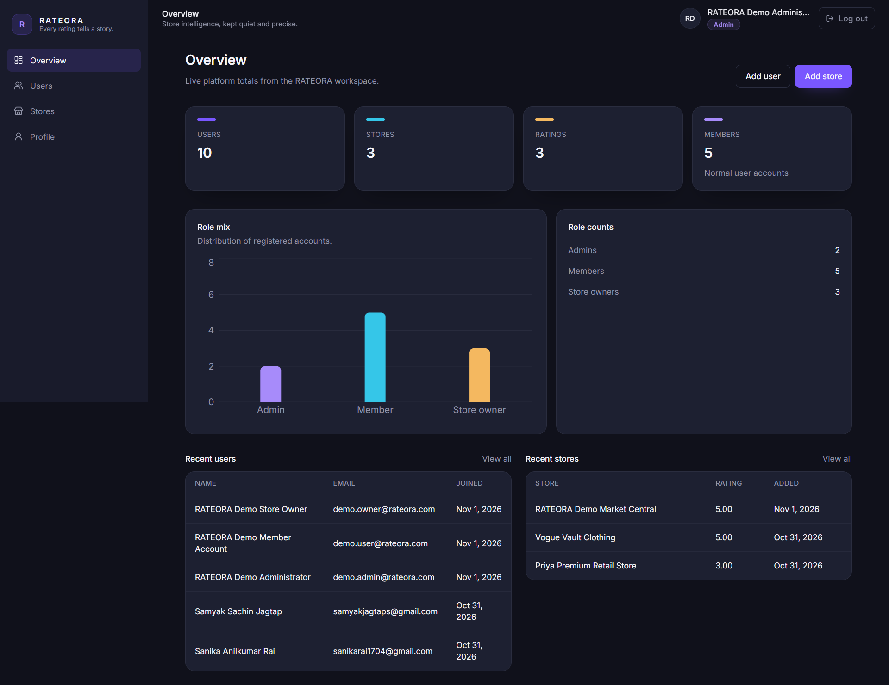
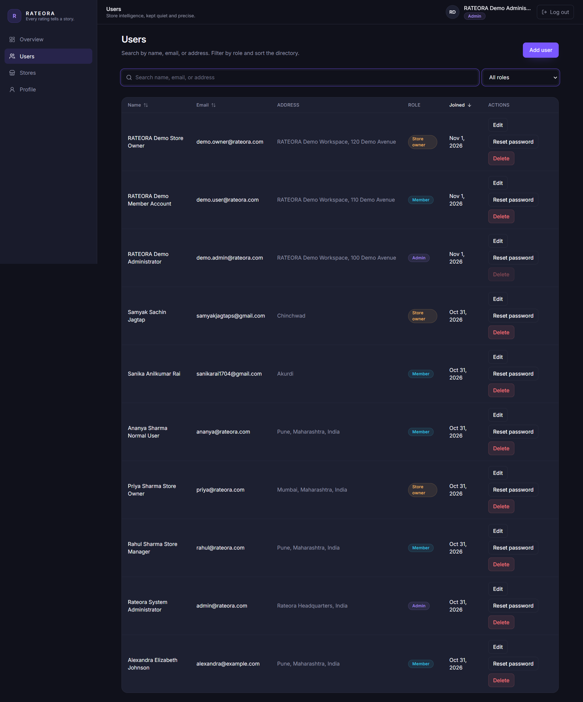
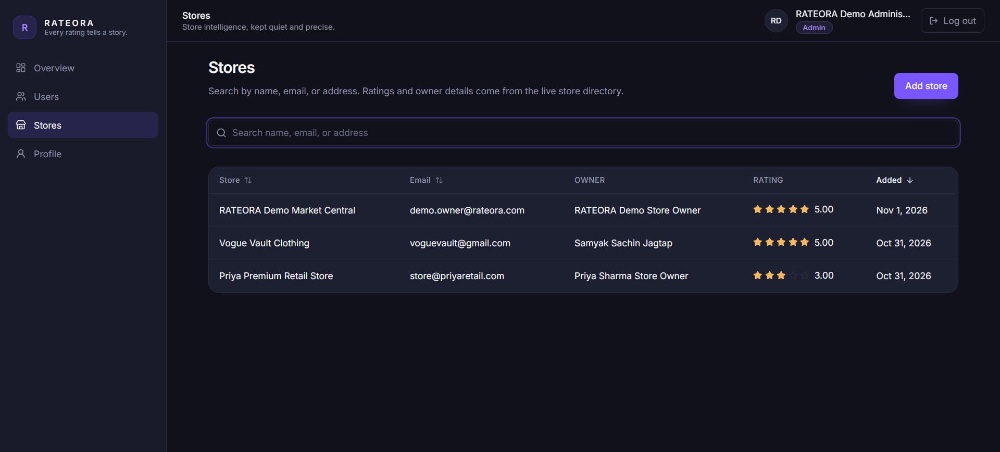
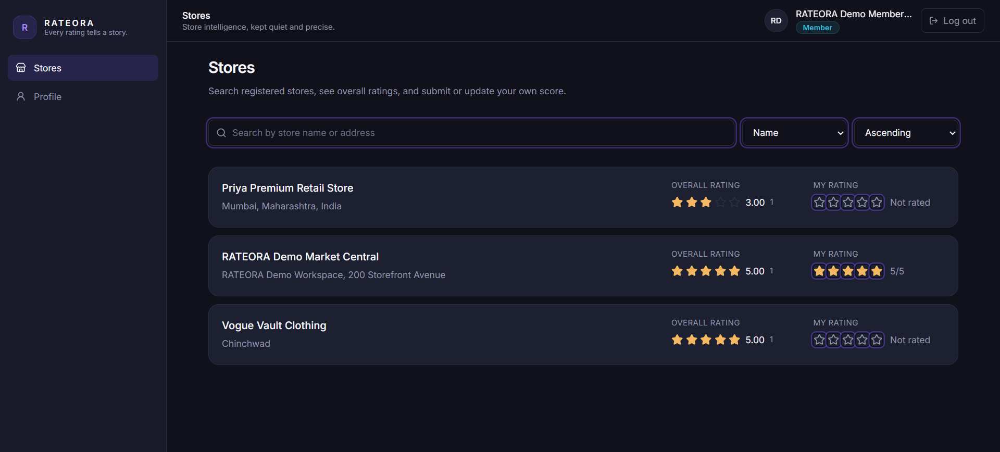
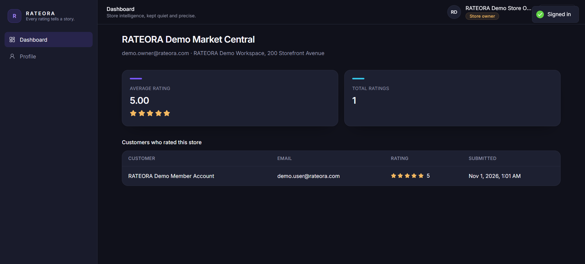
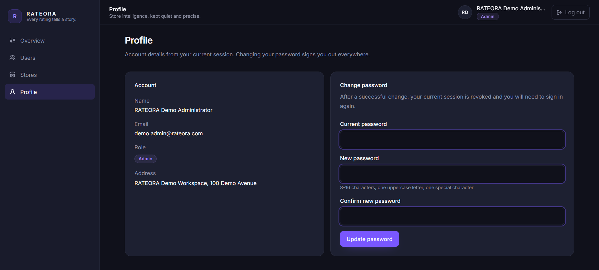
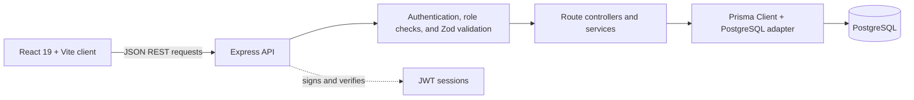

# RATEORA – Store Intelligence & Rating Platform

> **Every rating tells a story.**

RATEORA is a full-stack store rating and management platform with role-specific workspaces for administrators, normal users, and store owners. It combines store discovery, customer ratings, account management, and rating analytics in a responsive dark SaaS interface.

Live Demo

**Live Application:** https://rateora.onrender.com

Explore RATEORA's store discovery, rating system, and role-based dashboards.


## Contents

- [Overview](#overview)
- [Screenshots](#screenshots)
- [Features](#features)
- [Technology stack](#technology-stack)
- [System architecture](#system-architecture)
- [Project structure](#project-structure)
- [Prerequisites](#prerequisites)
- [Installation and local setup](#installation-and-local-setup)
- [Environment variables](#environment-variables)
- [Database and Prisma commands](#database-and-prisma-commands)
- [API overview](#api-overview)
- [Demo accounts](#demo-accounts)
- [Security considerations](#security-considerations)
- [Future enhancements](#future-enhancements)
- [Author and repository](#author-and-repository)

## Overview

RATEORA provides a shared store-rating platform with access determined by account role:

- **Admins** manage users and stores and review platform-wide statistics.
- **Normal Users** discover stores, review average ratings, and submit or update their own ratings.
- **Store Owners** monitor store performance and see the customer ratings associated with their store.

The frontend is a React single-page application. It communicates with a REST API built with Express. Prisma ORM connects the API to PostgreSQL, while JWT-based authentication and role checks protect private operations.

## Screenshots

The screenshots below show the actual RATEORA application across authentication, administration, store discovery, and account management.

### Authentication: Login and Registration





### Admin Workspace: Dashboard, User Management, Store Management







### Normal User Workspace: Store Discovery



### Store Owner Workspace: Dashboard



### Account Management: Profile



## Features

### Admin

- Dashboard statistics for users, stores, ratings, and account roles.
- Create, view, search, filter, sort, and paginate user records.
- Edit user details and role, reset passwords, and delete accounts with safeguards.
- Create stores and browse store records with owner and rating summaries.
- Prevent self-deletion and prevent deleting a Store Owner who still owns a store.

### Normal User

- Register as a normal user and sign in.
- Browse and search stores, with sorting and pagination.
- View overall store ratings and the current user's rating.
- Submit or update a rating from 1 to 5.
- View account details and change the account password.

### Store Owner

- View the assigned store's dashboard.
- Monitor average rating and total rating count.
- View customer names, email addresses, rating values, and submission dates.
- View account details and change the account password.

### Shared experience

- Responsive dark SaaS interface with violet and cyan accents.
- Role-based frontend routes and backend authorization.
- Search, sorting, filtering, and pagination for supported directories.
- Loading, empty, and error states across dashboard and directory views.
- Login page demo cards that fill the sign-in form; the user submits the form manually.

## Technology stack

| Area | Technologies |
| --- | --- |
| Frontend | React 19, Vite 8, Tailwind CSS 4 |
| Backend | Node.js, Express.js 5 |
| Database | PostgreSQL |
| ORM and driver | Prisma ORM 7, Prisma PostgreSQL adapter, `pg` |
| Authentication | JSON Web Tokens (`jsonwebtoken`), `bcrypt` |
| Validation | Zod |
| Charts | Recharts |
| Icons | Lucide React |
| UI and data tools | React Router, React Hook Form, Axios, React Hot Toast |

## System architecture



The client sends bearer tokens for authenticated API requests. The backend verifies the token, confirms the user's current role and token version, validates request bodies, and then invokes the relevant controller.

## Project structure

```text
RATEORA/
├── client/                       # React/Vite frontend
│   └── src/
│       ├── components/            # Shared UI, dashboards, tables, ratings
│       ├── context/               # Authentication context
│       ├── hooks/                 # Auth and directory query hooks
│       ├── pages/                 # Admin, auth, user, owner, and profile pages
│       ├── routes/                # Protected and role-specific routes
│       ├── services/              # Axios API calls
│       └── utils/                 # Constants, schemas, and formatters
├── prisma/
│   ├── migrations/                # PostgreSQL schema migrations
│   └── schema.prisma              # User, Store, Rating, and Role models
├── scripts/
│   └── create-demo-accounts.js    # Safe, rerunnable demo account bootstrap
├── src/
│   ├── config/                    # Prisma client configuration
│   ├── controllers/               # API request handlers
│   ├── middleware/                # Auth, validation, and error handling
│   ├── routes/                    # Express route definitions
│   ├── services/                  # Admin user-management logic and tests
│   ├── validators/                # Backend Zod schemas
│   ├── app.js                     # Express app and API mounts
│   └── server.js                  # Backend startup
├── package.json                  # Backend scripts and dependencies
├── prisma7.config.ts             # Prisma CLI schema, migrations, and datasource config
└── README.md
```

## Prerequisites

- Node.js **20.19+** or **22.12+** (required by the installed Vite and Prisma versions).
- npm.
- A reachable PostgreSQL database.

## Installation and local setup

1. Clone the repository and enter the project directory:

   ```powershell
   git clone https://github.com/sanika0517/RATEORA.git
   Set-Location RATEORA
   ```

2. Install backend and frontend dependencies:

   ```powershell
   npm install
   Set-Location client
   npm install
   Set-Location ..
   ```

3. Create a PostgreSQL database and configure the root `.env` file using the variable names below. Keep real values local and never commit the file.

4. Generate Prisma Client and apply the committed migrations:

   ```powershell
   npx prisma generate
   npx prisma migrate deploy
   ```

5. Start the backend and frontend in separate PowerShell terminals.

   Backend terminal, from the repository root:

   ```powershell
   Set-Location RATEORA
   $env:PORT = "5000"
   npm run dev
   ```

   Frontend terminal:

   ```powershell
   Set-Location RATEORA\client
   npm run dev -- --host localhost --port 5173 --strictPort
   ```

6. Open `http://localhost:5173`. Check backend and database connectivity at `http://localhost:5000/api/health`.

The backend package also provides `npm start` for a non-watch server process. The client provides `npm run build`, `npm run preview`, and `npm run lint`.

## Environment variables

The backend and Prisma CLI load the root `.env` file through `dotenv/config`. Configure the following variable names in that file; actual values are intentionally omitted from this README:

| Variable | Required | Purpose |
| --- | --- | --- |
| `DATABASE_URL` | Yes | PostgreSQL connection string used by Prisma. |
| `JWT_SECRET` | Yes | Secret key used to sign and verify JWTs. |
| `JWT_EXPIRES_IN` | No | JWT lifetime; the backend defaults to `1d`. |
| `PORT` | No | Backend port; defaults to `5000`. |
| `CLIENT_URL` | No | CORS origin; defaults to `http://localhost:5173`. |

The frontend currently targets `http://localhost:5000/api` in its client configuration; the backend should therefore use port 5000 for the supplied local setup commands.

## Database and Prisma commands

Prisma is a root development dependency. There are no custom Prisma npm scripts in `package.json`; invoke the installed CLI with `npx prisma`. The CLI reads `prisma7.config.ts`, which points to `prisma/schema.prisma`, `prisma/migrations/`, and `DATABASE_URL`.

| Command | Purpose |
| --- | --- |
| `npx prisma validate` | Validate the Prisma schema. |
| `npx prisma generate` | Generate Prisma Client. |
| `npx prisma migrate status` | Check migration status for the configured database. |
| `npx prisma migrate deploy` | Apply committed migrations to the configured database. |
| `npx prisma migrate dev --name <migration_name>` | Create and apply a development migration after a schema change. |

The repository currently contains the initial schema migration plus migrations for `tokenVersion` and a rating check. The safe setup path above applies these existing migrations with `migrate deploy`; it does not reset the database. The demo account bootstrap script, when intentionally run, prompts for passwords without echo and skips existing email addresses.

The root package's test script is `npm test` (`node --test`). A focused admin user-management test suite can be run with:

```powershell
node --test src/services/admin-user-management.service.test.js
```

## API overview

All endpoints are mounted under `/api`. Authenticated requests use an `Authorization: Bearer <token>` header.

| Method | Endpoint | Access | Purpose |
| --- | --- | --- | --- |
| `GET` | `/api/health` | Public | Check API and database connectivity. |
| `POST` | `/api/auth/register` | Public | Register a Normal User. |
| `POST` | `/api/auth/login` | Public | Authenticate any role. |
| `GET` | `/api/auth/me` | Authenticated | Return current session user details. |
| `POST` | `/api/auth/change-password` | Authenticated | Change the current user's password and revoke sessions. |
| `POST` | `/api/auth/logout` | Authenticated | Revoke the current user's existing sessions. |
| `GET` | `/api/admin/dashboard` | Admin | Fetch platform statistics and role counts. |
| `POST` | `/api/admin/users` | Admin | Create a user. |
| `GET` | `/api/admin/users` | Admin | Search, filter, sort, and paginate users. |
| `GET` | `/api/admin/users/:userId` | Admin | Fetch user details and optional owned-store summary. |
| `PATCH` | `/api/admin/users/:userId` | Admin | Edit user details and role. |
| `POST` | `/api/admin/users/:userId/reset-password` | Admin | Reset a user's password and revoke sessions. |
| `DELETE` | `/api/admin/users/:userId` | Admin | Delete an eligible user account. |
| `POST` | `/api/admin/stores` | Admin | Create a store for an eligible Store Owner. |
| `GET` | `/api/admin/stores` | Admin | Search, sort, and paginate stores with owner/rating summaries. |
| `GET` | `/api/stores` | Normal User | Search, sort, and paginate stores with rating summaries and the user's rating. |
| `POST` | `/api/ratings/:storeId` | Normal User | Submit or update a store rating from 1 to 5. |
| `GET` | `/api/owner/dashboard` | Store Owner | Fetch owned-store details, rating metrics, and customer ratings. |

Directory endpoints accept query options for search, sorting, role filtering where applicable, and pagination (`page` and `limit`).

## Demo accounts

These dedicated accounts are intended for reviewers. The login page displays these public demo credentials and fills the sign-in form when **Use Demo Account** is selected; sign-in still requires a manual submit.

| Role | Email |
| --- | --- |
| Admin | `demo.admin@rateora.com` |
| Normal User | `demo.user@rateora.com` |
| Store Owner | `demo.owner@rateora.com` |

Reviewers can use the demo account cards on the login page to populate the email and password fields. The card does not submit the login form; reviewers still sign in manually.

To provision missing demo accounts in a local database, run this from the repository root:

```powershell
node scripts/create-demo-accounts.js
```

The script prompts for each approved password without echoing it, skips an email that already exists (including case variants), and creates the dedicated demo store only alongside a newly created Store Owner account.

## Security considerations

- Passwords are hashed with bcrypt before storage; password hashes are not returned by authentication responses.
- JWT authentication checks the user's current role and `tokenVersion`; password changes and logout invalidate existing sessions.
- Backend routes enforce authentication and role authorization independently of frontend route guards.
- Zod validates authentication, account, store, and rating inputs on the backend; the client also validates forms.
- Helmet and CORS middleware are enabled by the Express app.
- Admin deletion prevents self-deletion and blocks deleting a Store Owner who still owns a store. User ratings use the database's configured cascade behavior.
- Demo credentials are public by design. Do not reuse them for personal accounts or production deployments.
- Keep `.env` values private and use a strong, unique `JWT_SECRET` outside local development.

## Future enhancements

- Add automated API integration tests against an isolated test database.
- Add audit history for administrative account and store changes.
- Add configurable rate limits for authentication endpoints.
- Add email verification and account recovery flows.
- Add exportable analytics and date-range filters for store rating trends.

## Author and repository

- **Author / maintainer:** [sanika0517](https://github.com/sanika0517)
- **GitHub repository:** [sanika0517/RATEORA](https://github.com/sanika0517/RATEORA)
